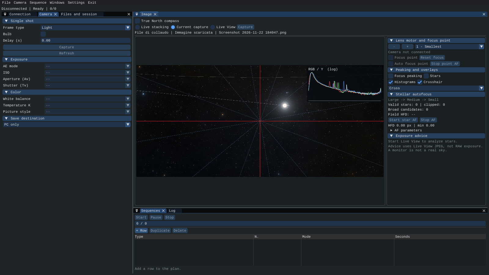
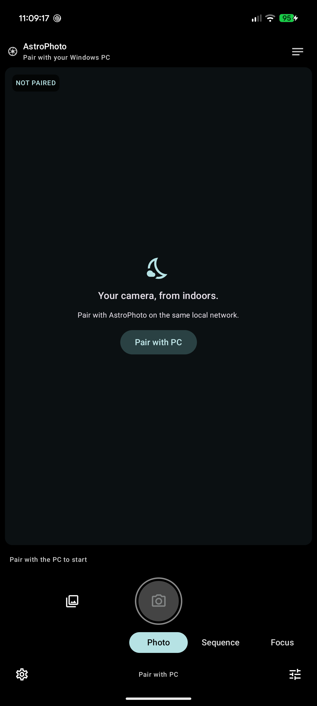
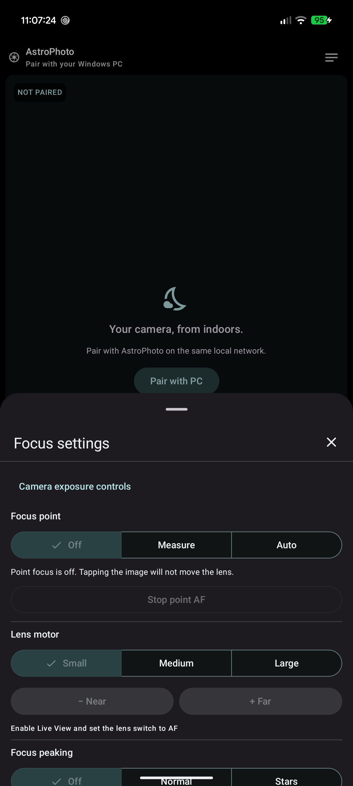
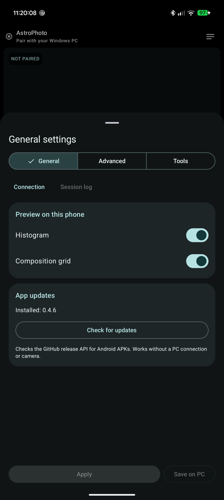
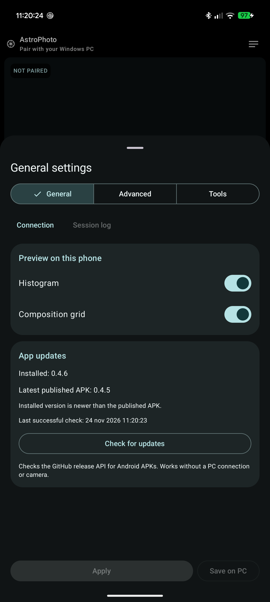

# AstroPhoto

Windows astrophotography capture and processing, with an Android remote.
C++20 and Dear ImGui on Windows; Kotlin, Jetpack Compose and Material 3 on
Android. Cameras and image files stay on the PC.



[Website](https://artur73737.github.io/AstroPhoto/) · [User guide](docs/USER_GUIDE.md) · [Releases](https://github.com/Artur73737/AstroPhoto/releases)

## Download

| Platform | Package |
| --- | --- |
| Windows 10/11 x64 | [AstroPhoto 0.10.7 MSI](https://github.com/Artur73737/AstroPhoto/releases/download/v0.10.7/AstroPhoto-0.10.7-x64.msi) |
| Android 8.0+ | [AstroPhoto Remote 0.4.6 APK](https://github.com/Artur73737/AstroPhoto/releases/download/v0.10.7/AstroPhotoRemote-0.4.6.apk) |

[Release notes, dependencies and SHA-256 checksums](https://github.com/Artur73737/AstroPhoto/releases/tag/v0.10.7)
accompany both packages. Windows and Android versions are independent.

The MSI installs **AstroController.exe**, Canon/ZWO runtimes, the ZWO driver,
ASTAP with offline catalogs, app-local Visual C++ dependencies and required
licenses. Project guides, example photos and development tools are not installed.
Canon USB transport uses Windows device support; a separate universal Canon
driver installer is not bundled.

The APK retains the release signing identity and upgrades earlier signed versions
in place. Remove an old developer-signed debug installation once before installing
the signed APK. An upgrade ends the in-memory session; scan a fresh PC QR afterwards.

## Android workspace

The viewfinder stays clear of permanent forms. Swipe or tap the mode strip below
the shutter. **Bottom-left Settings** opens general/session options;
**bottom-right Tune** opens the selected mode's parameters. Landscape uses a side
rail. Native camera controls, advanced configuration and host tools remain available.

| Camera workspace | Focus settings |
| --- | --- |
|  |  |

| General settings | Update check |
| --- | --- |
|  |  |

Actual Pixel 8 Pro captures from 24 November 2026, with no camera connected.
Disabled optical controls reflect that state; no preview is simulated. Earlier
connected-camera screenshots remain in [the capture directory](docs/site-captures).

**General → App updates → Check for updates** queries the GitHub API and shows
installed/latest APK versions and network errors. It works without a PC or camera
and does not offer a downgrade over a newer local APK.

## Camera workflows

| Camera | Capture and controls |
| --- | --- |
| Canon EOS 1100D | Single Light/Dark/Flat/Bias exposures, Bulb, sequence plans, delays/intervals, camera-reported ISO/Av/Tv choices and PC-only or PC+card saving |
| ZWO ASI | Continuous native sensor preview; frame/time recording presets, custom limits or Until stopped; multi-frame SER or numbered FITS/PNG/TIFF; SDK-reported gain/exposure/Auto controls, ROI, binning and sensor formats |

ZWO Start saves native frames; Stop finalizes accepted writes while leaving
preview active. Camera mutations remain locked during recording/finalization.
Exposures above 0.25 s show estimated frame timing, not hardware exposure telemetry.
See [ZWO Capture](docs/ZWO_CAPTURE.md) and [camera modules](docs/CAMERA_MODULES.md).

The image workspace includes normal/star peaking, histograms, reticles, native
Canon zoom and AF-gated lens drive, point measurement, camera-confirmed point AF,
and large → medium → small stellar autofocus. ZWO optics do not expose Canon
lens-motor functions. See [hardware qualifications](docs/HARDWARE_VALIDATION.md).

[RAW live stacking](docs/LIVE_STACKING.md) provides alignment, calibration,
rejection, processing, pause/resume, recovery and export workflows. Original
frames and metadata remain on disk. Real-sky qualification remains incomplete;
review the documented experimental limitations before field use.

[True North](docs/true-north/README.md) solves a loaded sky image or a ZWO live
frame. Its physical axis/mounting requirement cannot be checked from an image.
Absolute compass orientation remains experimental: [validation](docs/true-north/VALIDATION.md).

## Connect the phone

1. On Windows, open **Settings → Android / WebSocket → Start WS server**.
2. On Android, open Connection and scan the one-time PC QR on the same local network.
3. Choose a mode, open its settings and operate the PC-connected camera.

Pairing works without a camera: PC state, settings, schemas and tools remain
available, while camera-dependent actions stay disabled. Sessions use authenticated,
encrypted WebSocket traffic (AES-256-GCM, protocol v2). The Android foreground
service retains a connection in the background; force-closing the app ends it.
Photos are not saved on the phone.

[Android guide and protocol](docs/ANDROID_REMOTE.md) · [Android source/build guide](android/README.md)

## Validation

The [release report](docs/RELEASE_0_10_7.md) distinguishes software checks,
actual phone/host integration and historical camera results. The Pixel was paired
with the installed Windows host over the local network without a camera. State,
settings, schemas and the real GitHub update API were checked. Camera acquisition
and optical behavior were not requalified in this release.

## Build and architecture

Windows requires Visual Studio 2022 C++ tools, CMake 3.24+, PowerShell and matching
vendor SDK dependencies. Android requires JDK 17 and Android SDK/build tools 35.

```powershell
./scripts/build.ps1 -WithEDSDK -Configuration Release
./scripts/package-release.ps1 -BuildDirectory out/build -Version 0.10.7
./scripts/package-android.ps1
```

See [detailed build instructions](docs/README_ARCHIVE.md#build-and-run).
Core domain code is separate from vendor wrappers, presentation and transport.
Camera ownership, UI and MCP use synchronized owning threads; public C++ headers
are checked independently. The native C++ MCP server supports HTTP or stdio,
with one transport active at a time: [MCP reference](docs/MCP.md).
Android separates protocol, network, shared model, design system and feature modules.

## Documentation and notices

- [User guide](docs/USER_GUIDE.md): installation, capture, focus and troubleshooting.
- [Android UI validation](docs/ANDROID_UI_0_4_6.md) and [Live View performance](docs/LIVE_VIEW_PERFORMANCE.md).
- [Archived development details](docs/README_ARCHIVE.md): previous workflows and release notes.
- [Third-party notices](licenses): SDK, library and derived-code terms remain applicable.

Canon and EOS are trademarks of Canon Inc.; ZWO ASI names belong to ZWO.

